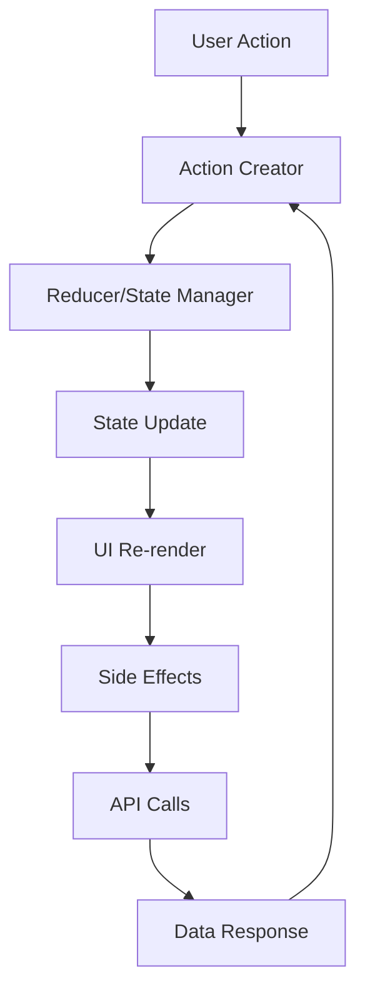

# Mobile App Architecture

## Overview

This document outlines the architecture patterns, design principles, and structural decisions for the mobile application. The architecture is designed to be scalable, maintainable, and performant across multiple platforms.

## Table of Contents

- [Architecture Patterns](#architecture-patterns)
- [Project Structure](#project-structure)
- [Data Flow](#data-flow)
- [State Management](#state-management)
- [Navigation](#navigation)
- [API Layer](#api-layer)
- [Security](#security)
- [Performance](#performance)
- [Testing Strategy](#testing-strategy)

## Architecture Patterns

### Clean Architecture

The application follows Clean Architecture principles with clear separation of concerns:

```
┌─────────────────────────────────────┐
│           Presentation Layer        │
│  (UI Components, Screens, ViewModels) │
├─────────────────────────────────────┤
│           Business Layer            │
│     (Use Cases, Business Logic)     │
├─────────────────────────────────────┤
│             Data Layer              │
│  (Repositories, Data Sources, APIs) │
└─────────────────────────────────────┘
```

#### Benefits
- **Testability**: Easy to unit test business logic
- **Maintainability**: Clear separation makes code easier to maintain
- **Flexibility**: Can swap implementations without affecting other layers
- **Scalability**: Well-defined boundaries support team scaling

### MVVM Pattern

For UI components, we use Model-View-ViewModel pattern:

```javascript
// Model
class User {
  constructor(id, name, email) {
    this.id = id;
    this.name = name;
    this.email = email;
  }
}

// ViewModel
class UserViewModel {
  constructor(userRepository) {
    this.userRepository = userRepository;
    this.user = null;
    this.loading = false;
    this.error = null;
  }

  async loadUser(userId) {
    this.loading = true;
    try {
      this.user = await this.userRepository.getUser(userId);
      this.error = null;
    } catch (error) {
      this.error = error.message;
    } finally {
      this.loading = false;
    }
  }
}

// View (React Native)
const UserScreen = ({ userId }) => {
  const viewModel = useUserViewModel();
  
  useEffect(() => {
    viewModel.loadUser(userId);
  }, [userId]);

  if (viewModel.loading) return <LoadingSpinner />;
  if (viewModel.error) return <ErrorMessage error={viewModel.error} />;
  
  return (
    <View>
      <Text>{viewModel.user?.name}</Text>
      <Text>{viewModel.user?.email}</Text>
    </View>
  );
};
```

## Project Structure

### React Native Structure

```
src/
├── components/           # Reusable UI components
│   ├── common/          # Common components (Button, Input, etc.)
│   ├── forms/           # Form-specific components
│   └── navigation/      # Navigation components
├── screens/             # Screen components
│   ├── auth/           # Authentication screens
│   ├── home/           # Home screen
│   └── profile/        # Profile screens
├── services/           # Business logic and data services
│   ├── api/            # API service layer
│   ├── auth/           # Authentication service
│   ├── storage/        # Local storage service
│   └── push/           # Push notification service
├── hooks/              # Custom React hooks
├── utils/              # Utility functions
├── types/              # TypeScript type definitions
├── constants/          # App constants
├── assets/             # Static assets (images, fonts)
└── __tests__/          # Test files
```

### Flutter Structure

```
lib/
├── models/             # Data models
├── views/              # UI screens and widgets
│   ├── screens/        # Main screens
│   ├── widgets/        # Reusable widgets
│   └── dialogs/        # Dialog widgets
├── controllers/        # Business logic controllers
├── services/           # Data services
│   ├── api/            # API services
│   ├── database/       # Local database
│   └── storage/        # Storage services
├── utils/              # Utility functions
├── constants/          # App constants
└── main.dart           # App entry point
```

### Native iOS Structure

```
Project/
├── Models/             # Data models
├── Views/              # UI components
│   ├── Screens/        # View controllers
│   ├── Components/     # Reusable UI components
│   └── Cells/          # Table/collection view cells
├── Controllers/        # View controllers
├── Services/           # Business services
│   ├── Network/        # Network layer
│   ├── Storage/        # Core Data stack
│   └── Auth/           # Authentication
├── Utils/              # Utility classes
├── Extensions/         # Swift extensions
└── Resources/          # Assets and resources
```

### Native Android Structure

```
app/src/main/
├── java/com/app/
│   ├── models/         # Data models
│   ├── ui/             # UI components
│   │   ├── activities/ # Activities
│   │   ├── fragments/  # Fragments
│   │   └── adapters/   # RecyclerView adapters
│   ├── services/       # Business services
│   │   ├── network/    # Network layer
│   │   ├── database/   # Room database
│   │   └── auth/       # Authentication
│   ├── utils/          # Utility classes
│   └── di/             # Dependency injection
└── res/                # Resources
```

## Data Flow

### Unidirectional Data Flow



### Data Flow Implementation

```javascript
// Action
const fetchUserAction = (userId) => ({
  type: 'FETCH_USER_REQUEST',
  payload: { userId }
});

// Reducer
const userReducer = (state = initialState, action) => {
  switch (action.type) {
    case 'FETCH_USER_REQUEST':
      return { ...state, loading: true };
    case 'FETCH_USER_SUCCESS':
      return { ...state, loading: false, user: action.payload };
    case 'FETCH_USER_FAILURE':
      return { ...state, loading: false, error: action.payload };
    default:
      return state;
  }
};

// Saga/Epic for side effects
function* fetchUserSaga(action) {
  try {
    const user = yield call(api.getUser, action.payload.userId);
    yield put({ type: 'FETCH_USER_SUCCESS', payload: user });
  } catch (error) {
    yield put({ type: 'FETCH_USER_FAILURE', payload: error.message });
  }
}
```

## State Management

### Redux Toolkit (React Native)

```javascript
import { createSlice, createAsyncThunk } from '@reduxjs/toolkit';

// Async thunk
export const fetchUser = createAsyncThunk(
  'user/fetchUser',
  async (userId, { rejectWithValue }) => {
    try {
      const response = await api.getUser(userId);
      return response.data;
    } catch (error) {
      return rejectWithValue(error.message);
    }
  }
);

// Slice
const userSlice = createSlice({
  name: 'user',
  initialState: {
    data: null,
    loading: false,
    error: null,
  },
  reducers: {
    clearUser: (state) => {
      state.data = null;
    },
  },
  extraReducers: (builder) => {
    builder
      .addCase(fetchUser.pending, (state) => {
        state.loading = true;
        state.error = null;
      })
      .addCase(fetchUser.fulfilled, (state, action) => {
        state.loading = false;
        state.data = action.payload;
      })
      .addCase(fetchUser.rejected, (state, action) => {
        state.loading = false;
        state.error = action.payload;
      });
  },
});

export default userSlice.reducer;
```

### Provider Pattern (Flutter)

```dart
// Model
class UserModel extends ChangeNotifier {
  User? _user;
  bool _loading = false;
  String? _error;

  User? get user => _user;
  bool get loading => _loading;
  String? get error => _error;

  Future<void> fetchUser(String userId) async {
    _loading = true;
    _error = null;
    notifyListeners();

    try {
      _user = await userRepository.getUser(userId);
    } catch (e) {
      _error = e.toString();
    } finally {
      _loading = false;
      notifyListeners();
    }
  }
}

// Usage in Widget
class UserScreen extends StatelessWidget {
  @override
  Widget build(BuildContext context) {
    return Consumer<UserModel>(
      builder: (context, userModel, child) {
        if (userModel.loading) {
          return CircularProgressIndicator();
        }
        
        if (userModel.error != null) {
          return Text('Error: ${userModel.error}');
        }
        
        return Text('Welcome ${userModel.user?.name}');
      },
    );
  }
}
```

## Navigation

### React Navigation (React Native)

```javascript
import { NavigationContainer } from '@react-navigation/native';
import { createStackNavigator } from '@react-navigation/stack';
import { createBottomTabNavigator } from '@react-navigation/bottom-tabs';

const Stack = createStackNavigator();
const Tab = createBottomTabNavigator();

const AuthStack = () => (
  <Stack.Navigator>
    <Stack.Screen name="Login" component={LoginScreen} />
    <Stack.Screen name="Register" component={RegisterScreen} />
  </Stack.Navigator>
);

const MainTabs = () => (
  <Tab.Navigator>
    <Tab.Screen name="Home" component={HomeScreen} />
    <Tab.Screen name="Profile" component={ProfileScreen} />
  </Tab.Navigator>
);

const App = () => {
  const isAuthenticated = useSelector(state => state.auth.isAuthenticated);
  
  return (
    <NavigationContainer>
      {isAuthenticated ? <MainTabs /> : <AuthStack />}
    </NavigationContainer>
  );
};
```

### Deep Linking

```javascript
const linking = {
  prefixes: ['myapp://'],
  config: {
    screens: {
      Home: 'home',
      Profile: 'profile/:userId',
      Product: 'product/:productId',
    },
  },
};

<NavigationContainer linking={linking}>
  {/* Navigation structure */}
</NavigationContainer>
```

## API Layer

### API Service Architecture

```javascript
class ApiService {
  constructor(baseURL, authService) {
    this.baseURL = baseURL;
    this.authService = authService;
    this.client = this.createClient();
  }

  createClient() {
    const client = axios.create({
      baseURL: this.baseURL,
      timeout: 10000,
    });

    // Request interceptor
    client.interceptors.request.use(
      async (config) => {
        const token = await this.authService.getToken();
        if (token) {
          config.headers.Authorization = `Bearer ${token}`;
        }
        return config;
      },
      (error) => Promise.reject(error)
    );

    // Response interceptor
    client.interceptors.response.use(
      (response) => response,
      async (error) => {
        if (error.response?.status === 401) {
          await this.authService.logout();
          // Navigate to login
        }
        return Promise.reject(error);
      }
    );

    return client;
  }

  async get(endpoint, params = {}) {
    const response = await this.client.get(endpoint, { params });
    return response.data;
  }

  async post(endpoint, data) {
    const response = await this.client.post(endpoint, data);
    return response.data;
  }
}
```

### Repository Pattern

```javascript
class UserRepository {
  constructor(apiService, storageService) {
    this.api = apiService;
    this.storage = storageService;
  }

  async getUser(userId) {
    // Try cache first
    const cachedUser = await this.storage.get(`user_${userId}`);
    if (cachedUser && !this.isCacheExpired(cachedUser)) {
      return cachedUser.data;
    }

    // Fetch from API
    const user = await this.api.get(`/users/${userId}`);
    
    // Cache the result
    await this.storage.set(`user_${userId}`, {
      data: user,
      timestamp: Date.now(),
    });

    return user;
  }

  async updateUser(userId, userData) {
    const updatedUser = await this.api.put(`/users/${userId}`, userData);
    
    // Update cache
    await this.storage.set(`user_${userId}`, {
      data: updatedUser,
      timestamp: Date.now(),
    });

    return updatedUser;
  }

  isCacheExpired(cachedData, ttl = 5 * 60 * 1000) { // 5 minutes
    return Date.now() - cachedData.timestamp > ttl;
  }
}
```

## Security

### Authentication & Authorization

```javascript
class AuthService {
  constructor(apiService, storageService) {
    this.api = apiService;
    this.storage = storageService;
  }

  async login(credentials) {
    const response = await this.api.post('/auth/login', credentials);
    const { token, refreshToken, user } = response;

    // Store tokens securely
    await this.storage.setSecure('accessToken', token);
    await this.storage.setSecure('refreshToken', refreshToken);
    await this.storage.set('user', user);

    return { token, user };
  }

  async refreshToken() {
    const refreshToken = await this.storage.getSecure('refreshToken');
    const response = await this.api.post('/auth/refresh', { refreshToken });
    
    await this.storage.setSecure('accessToken', response.token);
    return response.token;
  }

  async logout() {
    await this.storage.removeSecure('accessToken');
    await this.storage.removeSecure('refreshToken');
    await this.storage.remove('user');
  }
}
```

### Data Encryption

```javascript
import CryptoJS from 'crypto-js';

class EncryptionService {
  constructor(secretKey) {
    this.secretKey = secretKey;
  }

  encrypt(data) {
    return CryptoJS.AES.encrypt(JSON.stringify(data), this.secretKey).toString();
  }

  decrypt(encryptedData) {
    const bytes = CryptoJS.AES.decrypt(encryptedData, this.secretKey);
    return JSON.parse(bytes.toString(CryptoJS.enc.Utf8));
  }
}
```

## Performance

### Optimization Strategies

#### Code Splitting

```javascript
// React Native - Lazy loading screens
const LazyProfileScreen = React.lazy(() => import('./ProfileScreen'));

const ProfileScreenWrapper = () => (
  <Suspense fallback={<LoadingSpinner />}>
    <LazyProfileScreen />
  </Suspense>
);
```

#### Memoization

```javascript
// React hooks optimization
const ExpensiveComponent = React.memo(({ data, onUpdate }) => {
  const processedData = useMemo(() => {
    return data.map(item => ({
      ...item,
      processed: true,
    }));
  }, [data]);

  const handleUpdate = useCallback((id) => {
    onUpdate(id);
  }, [onUpdate]);

  return (
    <VirtualizedList
      data={processedData}
      renderItem={({ item }) => (
        <ListItem item={item} onPress={handleUpdate} />
      )}
    />
  );
});
```

#### Image Optimization

```javascript
// React Native image optimization
const OptimizedImage = ({ source, ...props }) => {
  return (
    <Image
      source={source}
      resizeMode="cover"
      loadingIndicatorSource={placeholderImage}
      fadeDuration={300}
      {...props}
    />
  );
};
```

### Memory Management

```javascript
// React Native memory optimization
class DataManager {
  constructor() {
    this.cache = new Map();
    this.maxCacheSize = 100;
  }

  addToCache(key, data) {
    if (this.cache.size >= this.maxCacheSize) {
      const firstKey = this.cache.keys().next().value;
      this.cache.delete(firstKey);
    }
    this.cache.set(key, data);
  }

  getFromCache(key) {
    return this.cache.get(key);
  }

  clearCache() {
    this.cache.clear();
  }
}
```

## Testing Strategy

### Testing Pyramid

```
┌─────────────────────┐
│    E2E Tests        │  ← Few, expensive, high confidence
├─────────────────────┤
│ Integration Tests   │  ← Some, moderate cost
├─────────────────────┤
│   Unit Tests        │  ← Many, cheap, fast
└─────────────────────┘
```

### Unit Testing

```javascript
// Component testing with React Testing Library
import { render, fireEvent, waitFor } from '@testing-library/react-native';
import { LoginScreen } from '../LoginScreen';

describe('LoginScreen', () => {
  it('should submit form with valid credentials', async () => {
    const mockLogin = jest.fn().mockResolvedValue({ user: { id: 1 } });
    
    const { getByPlaceholderText, getByText } = render(
      <LoginScreen onLogin={mockLogin} />
    );

    fireEvent.changeText(
      getByPlaceholderText('Email'),
      'user@example.com'
    );
    fireEvent.changeText(
      getByPlaceholderText('Password'),
      'password123'
    );
    fireEvent.press(getByText('Login'));

    await waitFor(() => {
      expect(mockLogin).toHaveBeenCalledWith({
        email: 'user@example.com',
        password: 'password123',
      });
    });
  });
});
```

### Integration Testing

```javascript
// API integration testing
describe('UserRepository', () => {
  let userRepository;
  let mockApiService;
  let mockStorageService;

  beforeEach(() => {
    mockApiService = {
      get: jest.fn(),
      post: jest.fn(),
    };
    mockStorageService = {
      get: jest.fn(),
      set: jest.fn(),
    };
    userRepository = new UserRepository(mockApiService, mockStorageService);
  });

  it('should fetch user from API when not cached', async () => {
    const userId = '123';
    const userData = { id: userId, name: 'John Doe' };
    
    mockStorageService.get.mockResolvedValue(null);
    mockApiService.get.mockResolvedValue(userData);

    const result = await userRepository.getUser(userId);

    expect(mockApiService.get).toHaveBeenCalledWith(`/users/${userId}`);
    expect(mockStorageService.set).toHaveBeenCalled();
    expect(result).toEqual(userData);
  });
});
```

### E2E Testing

```javascript
// Detox E2E testing for React Native
describe('Authentication Flow', () => {
  beforeEach(async () => {
    await device.reloadReactNative();
  });

  it('should login successfully with valid credentials', async () => {
    await element(by.id('email-input')).typeText('user@example.com');
    await element(by.id('password-input')).typeText('password123');
    await element(by.id('login-button')).tap();

    await waitFor(element(by.id('home-screen')))
      .toBeVisible()
      .withTimeout(5000);
  });
});
```

## Monitoring & Analytics

### Error Tracking

```javascript
import crashlytics from '@react-native-firebase/crashlytics';

class ErrorService {
  static logError(error, context = {}) {
    console.error('Error:', error);
    
    // Log to crashlytics
    crashlytics().recordError(error);
    
    // Add custom attributes
    Object.keys(context).forEach(key => {
      crashlytics().setAttribute(key, context[key]);
    });
  }

  static logEvent(eventName, parameters = {}) {
    // Log custom events
    crashlytics().log(`Event: ${eventName}`);
    analytics().logEvent(eventName, parameters);
  }
}
```

### Performance Monitoring

```javascript
import perf from '@react-native-firebase/perf';

class PerformanceService {
  static async measureAsyncOperation(operationName, operation) {
    const trace = perf().newTrace(operationName);
    await trace.start();
    
    try {
      const result = await operation();
      trace.putAttribute('success', 'true');
      return result;
    } catch (error) {
      trace.putAttribute('success', 'false');
      trace.putAttribute('error', error.message);
      throw error;
    } finally {
      await trace.stop();
    }
  }
}
```

## Deployment Architecture

### CI/CD Pipeline

```yaml
# .github/workflows/mobile-ci.yml
name: Mobile CI/CD

on:
  push:
    branches: [main, develop]
  pull_request:
    branches: [main]

jobs:
  test:
    runs-on: ubuntu-latest
    steps:
      - uses: actions/checkout@v2
      - uses: actions/setup-node@v2
        with:
          node-version: '16'
      - run: npm install
      - run: npm run test
      - run: npm run lint
      - run: npm run type-check

  build-ios:
    needs: test
    runs-on: macos-latest
    steps:
      - uses: actions/checkout@v2
      - uses: actions/setup-node@v2
      - run: npm install
      - run: cd ios && pod install
      - run: npm run build:ios

  build-android:
    needs: test
    runs-on: ubuntu-latest
    steps:
      - uses: actions/checkout@v2
      - uses: actions/setup-node@v2
      - uses: actions/setup-java@v2
        with:
          java-version: '11'
      - run: npm install
      - run: npm run build:android
```

## Conclusion

This architecture provides:

- **Scalability**: Modular structure supports team growth
- **Maintainability**: Clear separation of concerns
- **Testability**: Comprehensive testing strategy
- **Performance**: Optimized for mobile constraints
- **Security**: Built-in security best practices
- **Monitoring**: Comprehensive observability

The architecture is designed to evolve with the application and team needs while maintaining code quality and development velocity.

---

For implementation details, see the [API Documentation](./API_DOCUMENTATION.md) and [Component Library](./COMPONENT_LIBRARY.md).